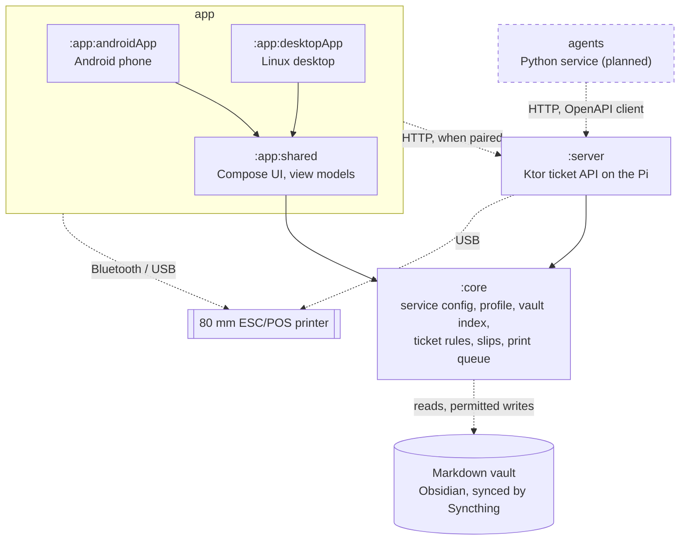

# Architecture

(This was generated by claude)

TicketRail is a personal task system that prints every task as a ticket on a thermal receipt printer. Phone and desktop apps file and move tickets, and a server on a Raspberry Pi can take over writing and printing.

When a vault is connected, the vault is the source of truth. How tickets are encoded in it, what the software may write and how it behaves under sync are defined in the **[Ticket Spec](_Ticket_Spec_General.md)**. Everything below implements that contract. Where this page and the spec disagree, the spec wins.

---

## Modules

Solid arrows are Gradle dependencies. Dotted arrows are runtime connections.

| Module | Role | Targets |
|---|---|---|
| `:core` | The ticket service as a library. Loads the service configuration and profile, indexes the vault into a Room database, applies the writes the spec permits, builds ESC/POS slip bytes and runs the print queue. Embedded in every app and in the server. | Android, JVM, linuxX64, linuxArm64 |
| `:app:shared` | Compose Multiplatform screens and view models shared by both apps. Exposes `:core` to them (`api` dependency). | Android, JVM |
| `:app:androidApp` | Android entry point: Bluetooth printing, "All files access" for the vault folder, the daily print alarm. | Android |
| `:app:desktopApp` | Desktop entry point for the Linux PC: USB printing through `/dev/usb/lp0`, keyboard shortcuts. | JVM |
| `:server` | Ktor (CIO) server: the ticket API, pairing and the daily print. Runs as a native binary on the Pi with the printer on USB. | JVM, linuxX64, linuxArm64 |
| `agents` | A separate Python service, not a Gradle module. Plugins (Google Calendar, Gmail, GitHub) run on a schedule, and an LLM step turns vague events into concrete tickets. It only talks to the ticket API. | Python |

Shared libraries: Room 3 with bundled SQLite, Okio for files, kaml and kotlinx-serialization for YAML and JSON, kotlinx-datetime, Koin for dependency injection.

## Two ways to run

The spec lets the ticket service run either embedded in an app or as a standalone server ([0.2](_Ticket_Spec_General.md#02-conformance)), but only one instance may write the vault at a time ([8.8](_Ticket_Spec_General.md#88-single-writer)). That gives two setups:

| | Standalone | Paired with the server |
|---|---|---|
| Who writes the vault | the `:core` embedded in one app | `:server` on the Pi |
| Where app edits go | the embedded core | the server over HTTP, queued while offline |
| Printing | phone over Bluetooth, PC over USB | the Pi over USB |
| Morning print | Android exact alarm | the Pi, with the phone off |
| Agents | not available | file tickets through the ticket API |

A paired app still reads and indexes its own copy of the vault, so it can show tickets offline.

## Design decisions

- **The vault always wins.** The database is an index of the vault plus the app's own history (events, prints, shifts, agent runs). Every edit names the ticket's hash, and if the file changed in the meantime the edit is refused as `stale` ([8.3](_Ticket_Spec_General.md#83-edits-from-the-app)).
- **Spec logic lives in common code.** Parsing, writing and slip building sit in `:core`'s `commonMain`, so the phone, the PC and the Pi read the vault and print slips identically.
- **Real files, not content URIs.** Writes go to a temp file and are renamed into place ([8.5](_Ticket_Spec_General.md#85-atomic-writes)), which needs real paths. On Android the app asks for "All files access" instead of using the Storage Access Framework.
- **Agents stay outside the Kotlin code.** They are plugins in a Python service that only calls the ticket API, through a client generated from its OpenAPI contract. Adding an agent never touches `core`, `app` or `server`.
- **Private network instead of HTTPS.** The native Ktor server can't serve HTTPS, so the phone, the PC and the Pi talk over Tailscale, and the server binds only to the Pi's Tailscale address.

## Where it stands

Phase 0 has the project skeleton with the Linux targets, the Room smoke test, the service configuration and profile loaders (spec [1.3](_Ticket_Spec_General.md#13-service-configuration-and-profile-location)), and the server's `/health` endpoint. Everything else on this page is planned. The phases are tracked as [milestones](https://github.com/zetenyLevay/ticketrail/milestones):

1. **Phone app:** ticket model, repository, Today and Board views, Bluetooth printing.
2. **Daily loop MVP:** reading and writing the vault per the spec, the scheduled print, shifts, the desktop app.
3. **Server and agents:** ticket API, pairing, deploy to the Pi, Tailscale, the first agents.
4. **Optional:** more agents, MCP servers, stats, focus timer.
